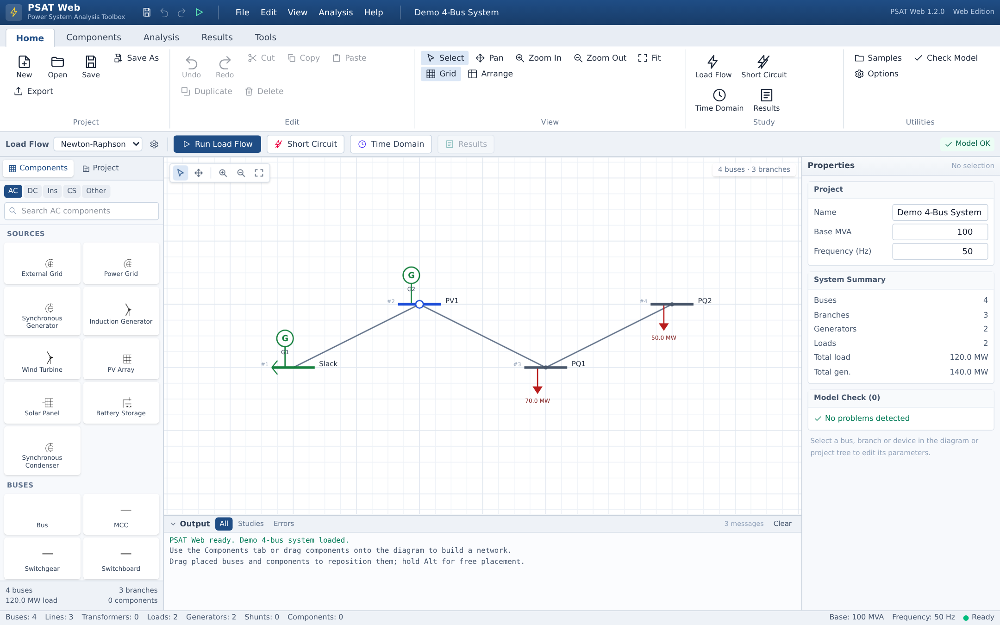

# Power System Analysis Tool (PSA)

Power System Analysis Tool (PSA) is a browser-native power system analysis workbench derived from the MATLAB-based
[PSAT](https://faraday1.ucd.ie/psat.html). It follows the ETAP style: a ribbon, a one-line diagram
editor, a component palette, a property grid, a study-case history and tabular/chart results.

[](https://github.com/ashcoft/psa-tool/actions/workflows/ci.yml)
[](https://github.com/ashcoft/psa-tool/actions/workflows/test.yml)
[](https://github.com/ashcoft/psa-tool/actions/workflows/pages.yml)
[](https://github.com/ashcoft/psa-tool/actions/workflows/docker-publish.yml)
[](https://github.com/ashcoft/psa-tool/releases)
[](LICENSE)
[](https://nextjs.org/)
[](https://react.dev/)
[](https://github.com/ashcoft/psa-tool/pkgs/container/psa-tool)



**Live workbench:** [ashcoft.github.io/psa-tool](https://ashcoft.github.io/psa-tool/) ·
**Container:** `ghcr.io/ashcoft/psa-tool:latest` ·
**Docs:** [User guide](docs/USER-GUIDE.md) · [Architecture](docs/ARCHITECTURE.md) ·
[Numerical methods](docs/NUMERICAL-METHODS.md) · [Deployment](docs/DEPLOYMENT.md) ·
[Roadmap](ROADMAP.md)

## Why this tool

- **Everything stays in the browser.** Projects are `.psa` files; no account, server database or
  upload.
- **A real one-line editor.** Drag components from the palette, place them anywhere, connect
  branches and rearrange the diagram without losing the electrical model.
- **Transparent numbers.** Every solver is deterministic, and every assumed value is recorded in
  the study log, the docs and `AGENTS.md`.
- **One workspace for screening studies.** Load flow, PV curve, OPF, faults, modal analysis,
  time domain and five specialty calculators share the same model, results history and export.

## Table of contents

- [Quick start](#quick-start)
- [Docker and GHCR](#docker-and-ghcr)
- [Optional server tier](#optional-server-tier)
- [GitHub Pages](#github-pages)
- [Capabilities](#capabilities)
- [Studies](#studies)
- [Keyboard shortcuts](#keyboard-shortcuts)
- [Documentation](#documentation)
- [Architecture](#architecture)
- [Numerical notes](#numerical-notes)
- [Testing and quality](#testing-and-quality)
- [Releases](#releases)
- [Contributing and security](#contributing-and-security)
- [Original PSAT](#original-psat)
- [License](#license)

## Quick start

Requirements: **Node.js 26** (see `.nvmrc`), npm and a modern browser. The test matrix also runs on
Node 24 and 25.

```bash
npm ci
npm run dev        # http://localhost:3000
```

Production build:

```bash
npm run build
npm run start
```

Quality gates:

```bash
npm run lint
npm run typecheck
npm run test:run
npx playwright install chromium
npm run test:e2e   # Chromium; starts the dev server on port 3456
```

`npm test` starts Vitest in watch mode; `npm run test:run` runs the suite once. `npm run verify`
runs lint, type check, tests and the production build.

## Docker and GHCR

```bash
docker build -t psa-tool .
docker run --rm -p 3000:3000 psa-tool

# or
docker compose up -d
```

The image uses the Next.js standalone output, runs as a non-root user and serves on port 3000. A
published image is available from the GitHub Container Registry:

```bash
docker pull ghcr.io/ashcoft/psa-tool:latest
docker run --rm -p 3000:3000 ghcr.io/ashcoft/psa-tool:latest
```

Tags are produced by `.github/workflows/docker-publish.yml`: `latest` for the default branch,
`1.3.0` and `1.3` for a `v1.3.0` tag, `main` for branch pushes and `sha-<short>` for every build.
The workflow uses `GITHUB_TOKEN` with `packages: write`; no extra secret is required. The package
is private by default: authenticate with `docker login ghcr.io` using a token that has
`read:packages`, or make the package public in its package settings for anonymous pulls.

## Optional server tier

`services/api` is a FastAPI service that runs power flow with pandapower and serves a versioned
cable and relay library from PostgreSQL. It is optional: the static workbench and the offline
build never call it.

```bash
# API only, in-memory catalogue
cd services/api
pip install -r requirements-dev.txt
uvicorn psa_api.main:app --port 8000

# Web app, API and PostgreSQL 17
POSTGRES_PASSWORD=change-me docker compose --profile server up --build
```

On the IEEE 9-bus case the service reproduces the browser engine's voltages, angles, flows and
losses to machine precision; `services/api/tests/test_parity.py` keeps it that way. Read
[services/api/README.md](services/api/README.md) before using it. The API has no authentication, so
run it behind a trusted network.

## GitHub Pages

The static workbench is live at **https://ashcoft.github.io/psa-tool/**.

The repository includes `.github/workflows/pages.yml`, which builds the static export and deploys
it with the official Pages artifact and deployment actions. The release workflow dispatches it with
the release commit, so the site always matches the latest release; pushes to `main` do not deploy on
their own. GitHub Pages must use the Actions
source: **Settings → Pages → Build and deployment → Source: GitHub Actions**. The workflow builds
with `NEXT_OUTPUT=export` and `NEXT_PUBLIC_BASE_PATH=/psa-tool` and writes `out/.nojekyll`. The
same build is available locally with `npm run build:pages`.

## Capabilities

### One-line diagram editor

- Ribbon with Home, Components, Analysis, Results and Tools tabs.
- Complete PSAT component library with AC, DC, Instruments, Controls and Other palettes (sources,
  buses, branches, loads/motors, protection, conversion, meters, relays, AVR/governor/PSS, DC
  elements, DC control and composite items).
- Component palette with category tabs, search and drag-and-drop placement.
- The palette and diagram share the same IEC symbol renderer, including catalog-specific generator,
  load, shunt and transformer symbols. Numbered protection relays (27, 81, 87, 21, 32, OCR, 79, MR,
  86, SST) and panel meters (V, A, PF) have their own badges, and the AC palette includes node,
  transmission tower, line trap and disconnect symbols.
- Every placed bus or non-branch specialty component can be dragged anywhere on the diagram.
  **Hold Alt** to bypass grid snap; the property panel X/Y fields accept exact coordinates.
- CAD-style selection: **Ctrl+A** selects the whole workspace, **Ctrl/Shift+click** adds or removes
  items, and dragging on empty canvas selects with a window (left-to-right) or crossing
  (right-to-left) marquee. Selected buses and non-branch specialty components move as a group;
  branches stay anchored to their bus endpoints. Workspace Delete removes the whole selection,
  while the Properties panel Delete removes only the primary element.
- Dropping a device away from a bus creates a bus at the drop point; bus-attached components stay
  free when no bus is nearby.
- Topology-aware **Auto Arrange** lays buses out by network depth from the slack bus and keeps
  attached components beside their bus.
- Project tree for buses, lines, transformers, generators, loads, shunts and specialty components.
- Select, pan, zoom (cursor-centred), fit, grid and snap-to-grid.
- Click-to-connect line and transformer tools.
- Context menu, duplicate, copy/paste, delete and undo/redo, including moves.
- Full property editing with validation feedback.
- IEEE-style bus, generator, load, shunt and transformer symbols.
- Result overlays for voltage limits and branch loading; load-flow MW flows show a direction arrow
  and short-circuit studies label every busbar with its fault current in kA.

### Project management

- `.psa` project save/open (JSON content) with validation and normalization.
- Close Project returns to an empty workspace; new, open and close remind you about unsaved changes.
- Sample systems: Demo 4-bus, IEEE 9-bus, IEEE 14-bus, a distribution feeder, and 1,000- and
  2,000-element grids covering 220 V to 500 kV with every catalog component.
- Settings persisted in the browser (solver, tolerances, simulation, overlays).
- Model check with clickable issues.

### Results and reporting

- Diagram overlays drawn as soon as a study completes: bus voltages and directional branch flows for
  load flow, bus fault currents in kA for short circuit. The results dialog opens on demand from
  **Results** or `F10`; **Report** produces the report.
- Study-case history for the current session.
- Result tables with engineering units.
- SVG charts (voltage profile, PV curve, dispatch, fault currents, eigenvalue scatter,
  time-domain traces).
- CSV export of every study, HTML/CSV/JSON report export and print support.

## Studies

| Study | Method | Output |
|-------|--------|--------|
| **Load flow** | Newton-Raphson (full Jacobian), fast-decoupled, DC, Gauss-Seidel | Bus, branch and generator tables; voltage profile; violations |
| **Continuation power flow** | Adaptive-step parameter continuation | PV curve, last converged point, critical bus, loading margin |
| **Optimal power flow** | Merit-order/equal-incremental-cost dispatch with AC verification | Dispatch, cost, losses and overload report |
| **Short circuit** | Bus impedance matrix (Zbus) | Three-phase, line-to-ground, line-to-line and double line-to-ground currents in kA, fault MVA, CT and breaker ratings |
| **Small-signal stability** | Kron-reduced multimachine model, complex shifted QR | Eigenvalues, damping ratios, mode classification and plot |
| **Time-domain simulation** | Classical swing equations, Euler/RK4/trapezoidal | Rotor angles, bus voltages, transient stability and critical clearing time |
| **Arc flash** | Lee spherical radiation model | Incident energy, boundary and PPE category |
| **Motor starting** | Locked-rotor current and terminal-voltage dip | Starting current, terminal voltage and voltage dip |
| **Harmonics** | Frequency-dependent network | Harmonic voltages, THD and IEEE 519 screening |
| **Protection** | IEC/IEEE inverse-time curves | Trip times, TCC plot and coordination margin |
| **Ground grid** | IEEE 80 simplified equations | Conductor size, GPR, touch and step voltages |

Specialty studies are screening calculations. Check the notes in each result and the assumptions in
[docs/NUMERICAL-METHODS.md](docs/NUMERICAL-METHODS.md) before using the numbers for design.

## Keyboard shortcuts

| Shortcut | Action |
|----------|--------|
| `Ctrl+N` / `Ctrl+O` / `Ctrl+S` | New / open / save project |
| `Ctrl+Z` / `Ctrl+Y` | Undo / redo |
| `Ctrl+A` | Select all workspace elements |
| `Ctrl+C` / `Ctrl+V` / `Ctrl+X` / `Ctrl+D` | Copy / paste / cut / duplicate |
| `Delete` | Delete the selected element |
| `F5` | Load flow |
| `F6` | Continuation power flow |
| `F7` | Short circuit |
| `F8` | Optimal power flow |
| `F9` | Time-domain simulation |
| `F10` | Open results |
| `Ctrl+0` | Fit diagram to window |
| `Ctrl++` / `Ctrl+-` | Zoom in / out |
| `Esc` | Cancel the current tool, clear selection or close a dialog |
| `Alt` + drag | Free positioning without grid snap |

## Documentation

| Document | Contents |
|----------|----------|
| [User guide](docs/USER-GUIDE.md) | Build a diagram, place components, run studies, read results, troubleshoot |
| [Architecture](docs/ARCHITECTURE.md) | Layers, model, study pipeline, editing state, testing and how to add a study |
| [Numerical methods](docs/NUMERICAL-METHODS.md) | Solver behaviour and every current assumption |
| [Deployment](docs/DEPLOYMENT.md) | Local, Docker, GHCR, GitHub Pages, Vercel and release flow |
| [Roadmap](ROADMAP.md) | Gap analysis, milestones, prioritized backlog and quality gates |
| [Changelog](CHANGELOG.md) | Release history generated by semantic-release |
| [Contributing](CONTRIBUTING.md) | Setup, conventions, commit format and PR checklist |
| [Security](SECURITY.md) | Reporting policy and security model |
| [Third-party notices](THIRD_PARTY_NOTICES.md) | PSAT attribution and GPL terms for derived code |

## Architecture

```text
src/
├── app/                 # Next.js App Router (page shell, global styles)
├── components/          # UI
│   ├── TitleBar.tsx     # Project name, menus and quick access
│   ├── Ribbon.tsx       # ETAP-style ribbon definition and renderer
│   ├── Toolbar.tsx      # Study toolbar (method, run buttons, model state)
│   ├── Sidebar.tsx      # AC/DC/Ins/CS/Other component palette and project tree
│   ├── Canvas.tsx       # One-line diagram renderer and interaction
│   ├── PropertiesPanel.tsx
│   ├── ResultsDialog.tsx / ReportDialog.tsx / Chart.tsx
│   ├── SettingsDialog.tsx / SampleDialog.tsx / InfoDialogs.tsx
│   └── OutputWindow.tsx
├── lib/
│   ├── powerflow-methods.ts  # Ybus, NR, fast-decoupled, DC, Gauss-Seidel
│   ├── cpf.ts                # Parameter-continuation PV curve
│   ├── opf.ts                # Economic dispatch and OPF variants
│   ├── fault.ts              # Zbus short-circuit engine
│   ├── stability.ts          # Modal analysis and complex QR solver
│   ├── timeseries.ts         # Classical time-domain simulation
│   ├── studies.ts            # Study runner facade
│   ├── results-export.ts     # Tables, CSV and report sections
│   ├── project.ts            # Serialization, validation, statistics
│   ├── component-catalog.ts  # Full PSAT component catalog and defaults
│   ├── component-utils.ts    # Component anchors and nearest-bus helpers
│   ├── samples.ts            # Ready-to-run systems
│   ├── large-samples.ts      # Deterministic 1,000/2,000-element grid generator
│   ├── settings.ts           # Persisted application settings
│   └── useProject.ts         # Project state, history and editing actions
├── types/               # Shared TypeScript data structures
└── test/                # Vitest setup
services/
├── api/                 # FastAPI + pandapower service and tests
└── catalog/             # Equipment library notes and provenance
docs/                    # User, architecture, numerical and deployment guides
playwright/              # End-to-end specs
```

See [docs/ARCHITECTURE.md](docs/ARCHITECTURE.md) for the data flow and the checklist for adding a
study.

## Numerical notes

- The model stores MW, Mvar and kV, and the property panel shows angles in degrees. Bus angles are
  stored in radians and converted for display. Solvers convert to per-unit on the system MVA base.
- Diagram coordinates are grid units; one unit is 100 px at 100 % zoom.
- The short-circuit engine currently assumes `Xd″ = 0.05 p.u.` and `Z0 = 0.5 Z1` because sequence
  data is not part of the model.
- Stability and time-domain studies use a classical multimachine model with deterministic inertia
  and damping values.
- Continuation power flow scales both load and non-slack generation by `1 + lambda` and halves the
  step when a solution is lost.

The full list is in [docs/NUMERICAL-METHODS.md](docs/NUMERICAL-METHODS.md) and `AGENTS.md`.

## Testing and quality

The repository has **307 unit/component tests**, **33 Chromium end-to-end specs** and **45 server
tier tests**. GitHub Actions runs lint, type check, unit tests, coverage, the production build and
Playwright on pushes and pull requests; the `API` workflow runs ruff, pytest with a PostgreSQL
service container and a container build. Codacy and SonarCloud provide static analysis.

```bash
npm run test:coverage   # coverage report
npm run verify          # lint + typecheck + tests + build
cd services/api && python -m pytest   # server tier
```

## Releases

Releases are automated with [semantic-release](https://github.com/semantic-release/semantic-release)
and driven by [Conventional Commits](https://www.conventionalcommits.org/). The `Release` workflow
runs on every push to `main`; commit messages determine the version bump (`fix:` patch, `feat:`
minor, `feat!:`/`BREAKING CHANGE:` major).

The container workflow publishes the matching image to GHCR, and the Pages workflow rebuilds the
static workbench.

## Contributing and security

- Read [CONTRIBUTING.md](CONTRIBUTING.md) before opening a pull request.
- Report vulnerabilities privately through [SECURITY.md](SECURITY.md); do not open a public issue.
- The development plan and prioritized backlog are in [ROADMAP.md](ROADMAP.md).

## Original PSAT

The application is abbreviated **PSA**. **PSAT** refers to the original toolbox it is derived from.

This project is a browser-based port of the original
[PSAT — Power System Analysis Toolbox](https://faraday1.ucd.ie/psat.html) developed by Federico
Milano.

Original PSAT is Copyright (C) 2002–2016 Federico Milano and is free software under the GNU General
Public License v3.

## License

MIT for the original code in this repository. See [LICENSE](LICENSE) and
[THIRD_PARTY_NOTICES.md](THIRD_PARTY_NOTICES.md); the original PSAT and `psat-converted/` remain under
their upstream GPL terms.
