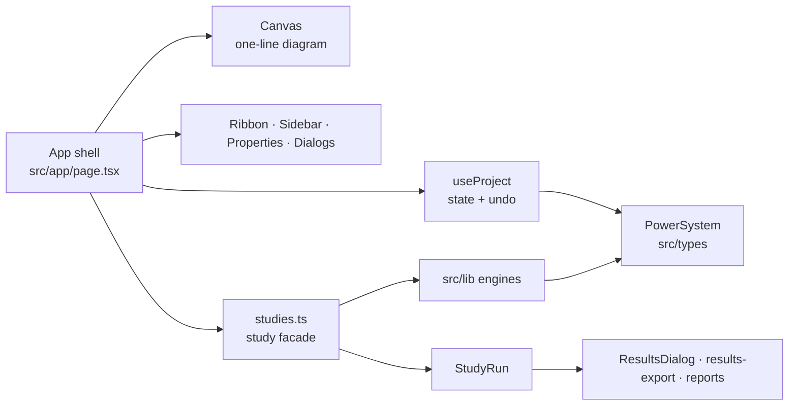

# Architecture

Power System Analysis Tool (PSA) is a Next.js App Router application with a pure TypeScript analysis core. The UI never
performs power-system mathematics directly; it calls `src/lib` engines and renders the results.

## Layers

| Layer | Location | Responsibility |
|-------|----------|----------------|
| App shell | `src/app/page.tsx` | Owns settings, selection, study history, dialogs and action dispatch |
| Editing state | `src/lib/useProject.ts` | System state, undo/redo, clipboard and element actions |
| Diagram | `src/components/Canvas.tsx` | Rendering, hit testing, dragging, connection and view transforms |
| Panels | `src/components/*` | Ribbon, sidebar palette/tree, properties, output and dialogs |
| Study facade | `src/lib/studies.ts` | Runs an engine and wraps the result as a `StudyRun` |
| Engines | `src/lib/*.ts` | Power flow, CPF, OPF, fault, stability, time domain and specialty studies |
| Export | `src/lib/results-export.ts`, `reports.ts` | Tables, CSV, HTML, JSON and report sections |
| Model | `src/types/index.ts` | Shared engineering data structures |

## Model

`PowerSystem` is the single source of truth:

- `buses`, `lines`, `transformers`, `generators`, `loads`, `shunts` are solved by the engines.
- Model elements carry an optional `symbol` IEC type set by the catalog. The canvas renders the
  same symbol shown in the palette, and the field is preserved by project save/open.
- `components` stores generic catalog elements (DC, instruments, controls, protection and
  composite items). They are persisted, drawn and edited but do not enter the admittance matrix.
- `baseMVA`, `baseFreq`, `name` and `slackBus` are system metadata.

Coordinates are grid units where **1 unit = 100 px at 100 % zoom**. Bus angles are stored in
radians; the property panel converts to and from degrees.

## Study pipeline

1. The page validates the model and calls `runStudy(kind, system, settings)`.
2. `studies.ts` selects the engine and converts engine output into a discriminated `StudyRun`.
3. The page appends the run to session history and opens `ResultsDialog`.
4. `studyTables` produces `TableData` for the dialog, CSV and reports.
5. `studyReport` reuses the shared report generator and appends study-specific tables.

### Adding a study

1. Add the engine under `src/lib/` and unit tests beside it.
2. Add the result type and a `StudyRun` variant in `studies.ts`.
3. Add a `run<Study>Study` function and a `StudyKind` branch.
4. Add tables in `results-export.ts` and handle the new kind in `studyReport`.
5. Add tabs, stat cards and a chart in `ResultsDialog.tsx`.
6. Add the ribbon action and `handleAction` case in `page.tsx`.
7. Add an E2E path that runs the study and opens its result tab.
8. Update `README.md`, `ROADMAP.md` and `AGENTS.md` when assumptions change.

## Editing state and undo

`useProject` keeps `{ system, name, past, future, dirty }`. Element creation and editing actions
push the previous system onto `past`. Drags use explicit gesture boundaries: `beginMove` records a
snapshot at mouse-down, the canvas updates coordinates during mouse-move, and `endMove` pushes the
snapshot once at mouse-up. A pause therefore cannot split one drag into several undo steps, and two
quick drags remain separate. The generic commit path still coalesces consecutive edits inside a
600 ms window.

State updaters must stay pure: React StrictMode invokes them twice, and writing refs or mutating
history inside an updater loses entries.

## Diagram interaction

`Canvas` draws with the 2D context and keeps a `deviceHitsRef` list for generator, load and shunt
symbols. Hit testing checks devices, generic components, buses, lines and transformers in that
order. Buses and non-branch generic components are draggable; branch-like components are anchored
to the midpoint of their two buses.

Palette drag-and-drop uses the `application/x-psat-component` data transfer type. The page decides
whether a drop creates a bus, attaches a device to a nearby bus or places a free-standing generic
component.

## Persistence

- Projects are `.psa` files (JSON content) produced by `serializeProject` and validated by `deserializeProject` and
  `normalizeSystem`.
- Settings are stored in `localStorage` under `psat-web.settings.v1`.
- Study results are session-only. Export CSV or a report to keep them.

## Testing

| Layer | Tool | Notes |
|-------|------|-------|
| Numerical engines | Vitest | Deterministic assertions on the demo and IEEE cases |
| State and utilities | Vitest + Testing Library | Hooks, project normalization, export |
| Components | Vitest + Testing Library | Ribbon, properties, results and specialty dialogs |
| End-to-end | Playwright (Chromium) | Workbench load, studies, editing, drag-and-drop, mobile layout |

`npm run test:coverage` produces the coverage report. CI runs lint, type check, unit tests, build
and the Playwright suite.
